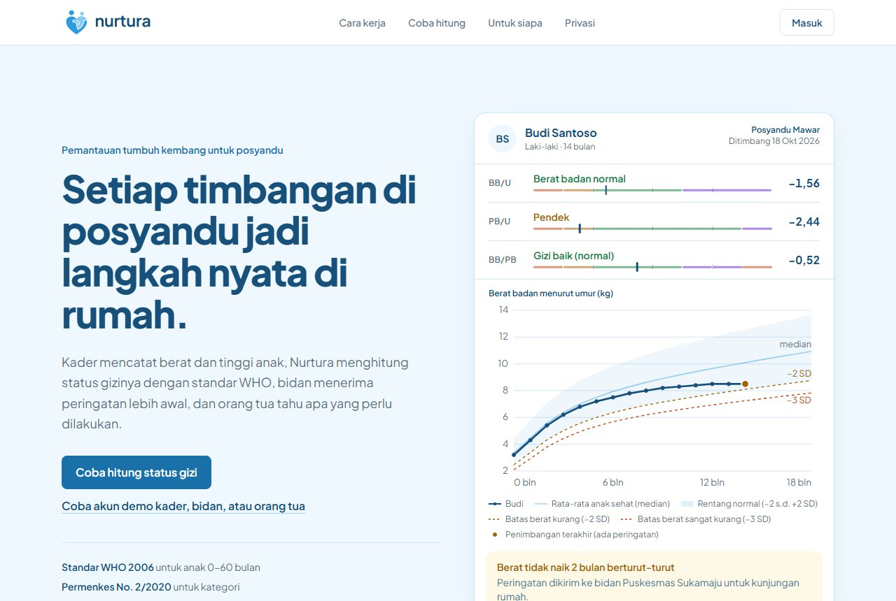
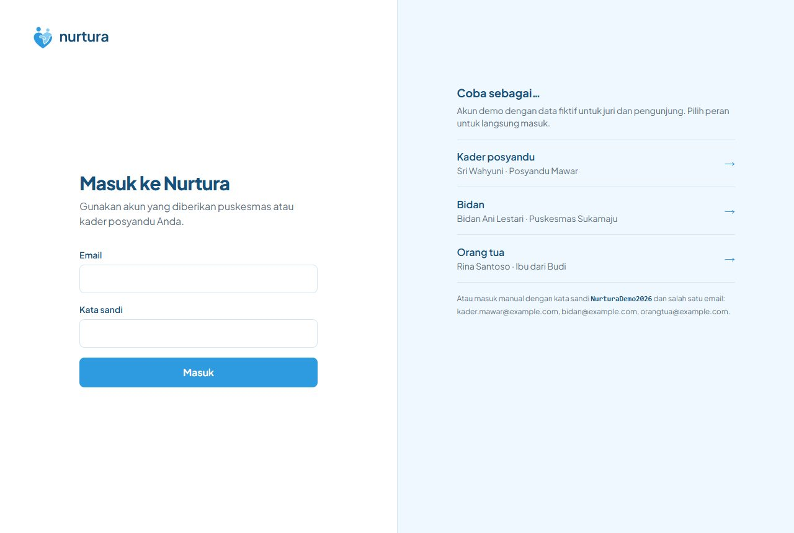
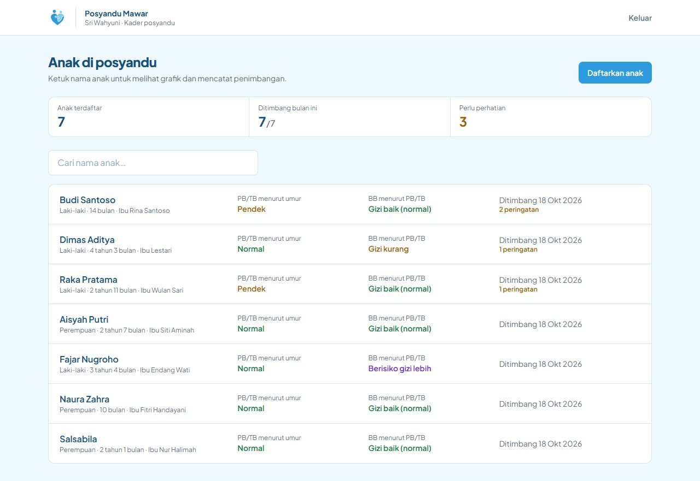
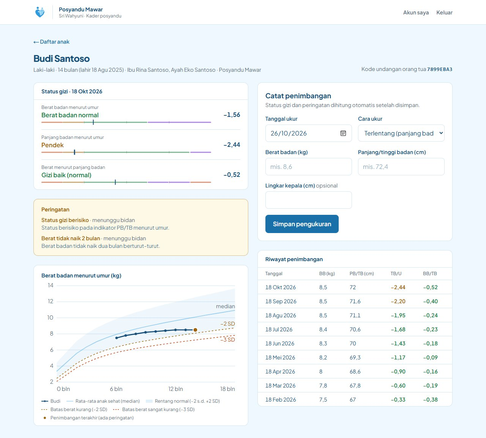
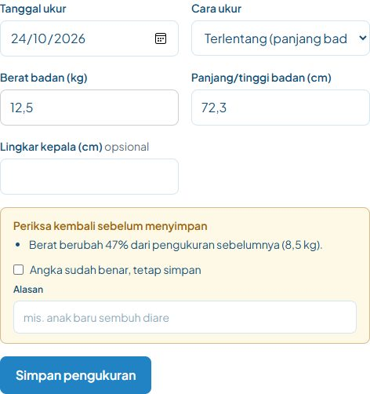
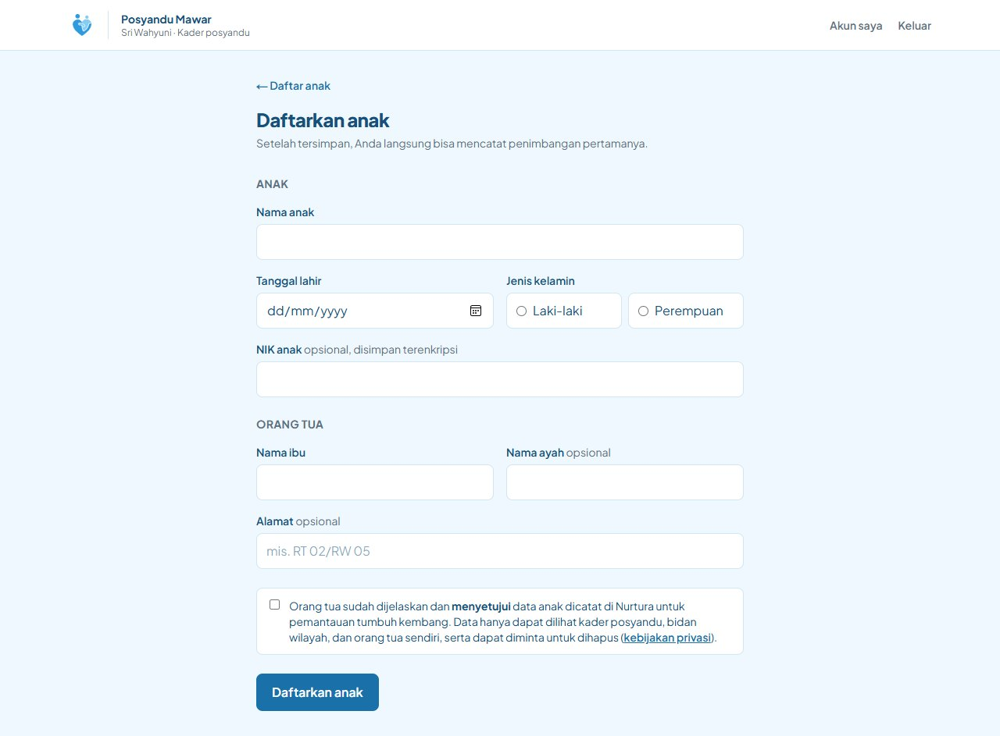
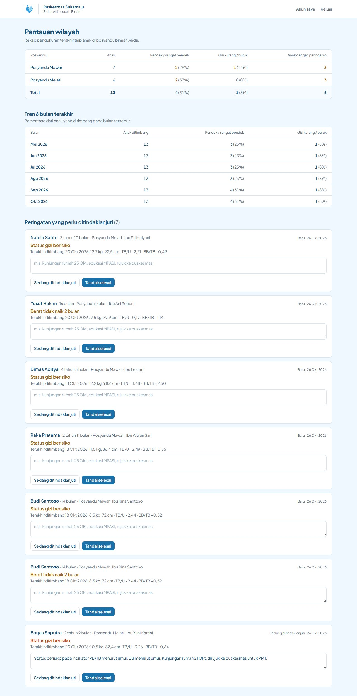
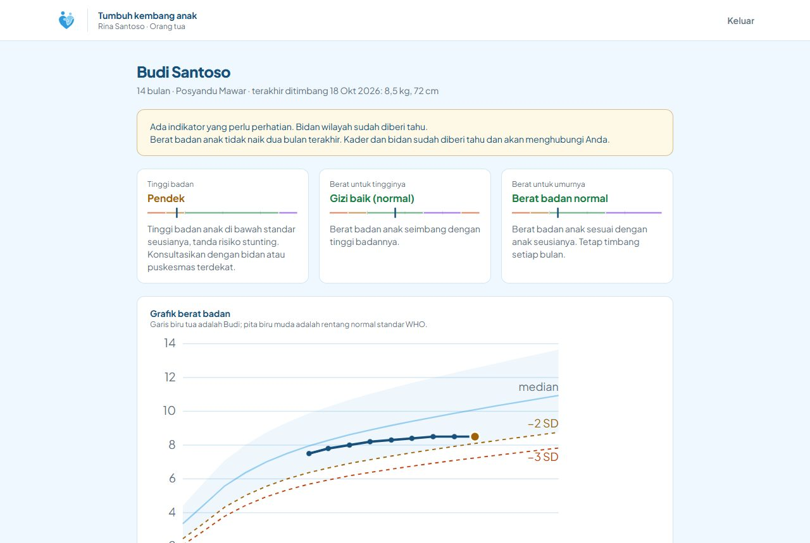
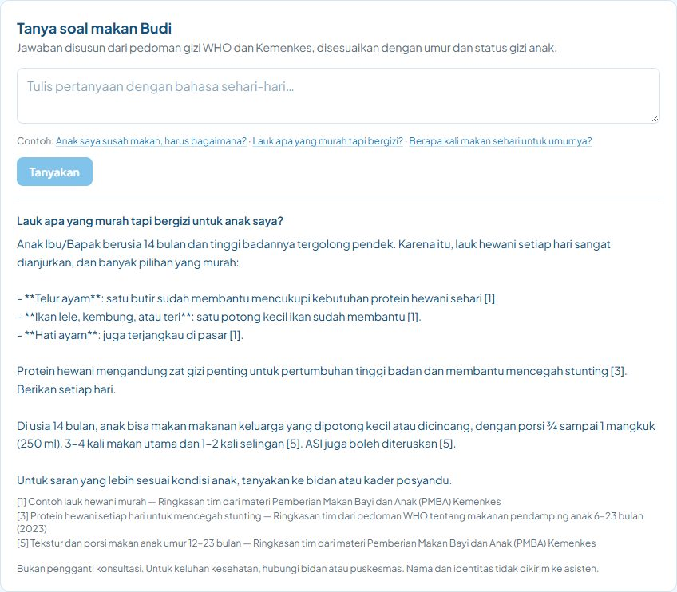
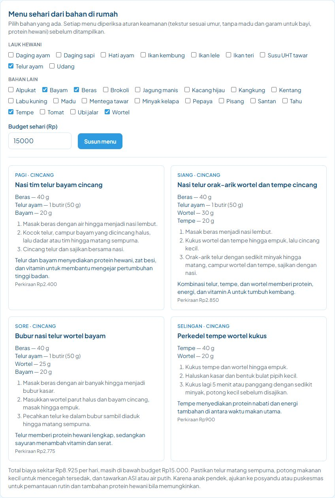

# Panduan Penggunaan Nurtura

Nurtura punya tiga peran utama: **kader posyandu**, **bidan/puskesmas**, dan **orang tua**. Setiap peran hanya
melihat data yang menjadi haknya. Panduan ini memakai akun demo dengan data fiktif.

- Alamat: https://nurtura.sbs
- Kata sandi semua akun demo: `NurturaDemo2026`

| Peran | Email demo |
|---|---|
| Kader posyandu | kader.mawar@example.com (Posyandu Mawar), kader.melati@example.com (Posyandu Melati) |
| Bidan | bidan@example.com |
| Orang tua | orangtua@example.com |
| Admin | admin@example.com |

---

## 1. Pengunjung (tanpa akun)

Halaman depan menjelaskan masalah yang diselesaikan dan cara kerja Nurtura. Bagian **Coba hitung** bisa dipakai siapa
saja tanpa masuk:

1. Isi tanggal lahir, tanggal ukur, jenis kelamin, berat (kg), panjang/tinggi (cm), dan cara ukur.
2. Tekan **Hitung status gizi**.
3. Hasilnya keluar untuk tiga indikator WHO (BB/U, PB-TB/U, BB/PB-TB), lengkap dengan nilai z, kategori sesuai
   Permenkes No. 2 Tahun 2020, dan penjelasan dalam bahasa awam.

Data kalkulator tidak disimpan.

## 2. Masuk

Buka **Masuk** di pojok kanan atas. Ada dua cara masuk:

- **Coba sebagai…:** pilih salah satu peran demo untuk langsung masuk.
- **Masuk manual:** isi email dan kata sandi.

Setelah masuk, Anda langsung dibawa ke beranda sesuai peran. Tombol **Keluar** ada di bilah atas.

---

## 3. Kader posyandu

### Melihat daftar anak

Beranda kader berisi:

- **Ringkasan:** jumlah anak terdaftar, jumlah anak yang sudah ditimbang bulan ini, dan jumlah anak yang perlu perhatian.
- **Daftar anak:** anak dengan peringatan selalu tampil paling atas. Gunakan kolom **Cari nama anak** untuk menemukan
  anak dengan cepat.

### Mencatat penimbangan

1. Ketuk nama anak. Halaman detail menampilkan:
   - status gizi terakhir dalam bentuk **skala z** (garis berwarna dengan penanda posisi anak);
   - peringatan yang masih aktif;
   - grafik berat badan menurut umur dengan garis referensi WHO;
   - riwayat pengukuran.
2. Di formulir **Catat penimbangan**, isi tanggal ukur, berat (kg), dan panjang/tinggi (cm). Desimal boleh ditulis
   dengan koma atau titik. Lingkar kepala tidak wajib diisi.
3. Pilih cara ukur. Anak di bawah 2 tahun biasanya diukur **terlentang**, sedangkan anak 2 tahun ke atas diukur
   **berdiri**. Bila cara ukur tidak sesuai umur, sistem menyesuaikan angkanya sendiri (±0,7 cm) sesuai standar WHO.
4. Tekan **Simpan pengukuran**. Status gizi dihitung otomatis, lalu peringatan dibuat bila ada tanda risiko.

### Cek data tidak wajar

Bila angkanya janggal, sistem meminta Anda memeriksa ulang sebelum menyimpan. Data dianggap janggal bila:

- berat berubah lebih dari 30% dari penimbangan sebelumnya;
- tinggi turun lebih dari 1 cm;
- nilai z berada di luar batas yang masuk akal menurut WHO;
- tanggal ukur tidak lebih baru dari pengukuran terakhir.

Periksa kembali timbangan dan alat ukur. Bila angkanya memang benar, centang **Angka sudah benar, tetap simpan**, tulis
alasannya (mis. "anak baru sembuh diare"), lalu simpan.
Alasan itu ikut tercatat agar bidan bisa menelusurinya.

### Peringatan otomatis

Sistem membuat peringatan untuk bidan pada tiga kondisi:

| Peringatan | Kapan muncul |
|---|---|
| Berat tidak naik 2 bulan | Kenaikan berat di bawah standar KBM dua bulan berturut-turut (untuk anak 12 bulan ke atas: berat tetap atau turun) |
| Pertumbuhan melambat | Nilai z turun lebih dari 0,5 SD dalam tiga pengukuran terakhir |
| Status gizi berisiko | Salah satu indikator masuk kategori pendek, kurang, buruk, atau berisiko lebih |

### Mendaftarkan anak baru

1. Di beranda kader, tekan **Daftarkan anak**.
2. Isi data anak (nama, tanggal lahir, jenis kelamin, dan NIK bila ada) serta data keluarga (nama ibu, nama ayah,
   dan alamat).
3. Bacakan kebijakan privasi kepada orang tua, lalu centang persetujuannya. Pendaftaran tidak bisa disimpan tanpa
   persetujuan ini.
4. Tekan **Daftarkan anak**. Setelah tersimpan, halaman anak menampilkan **kode undangan**. Berikan kode itu kepada orang tua agar mereka bisa
   memantau anaknya dari rumah.

NIK disimpan dalam bentuk terenkripsi (AES-256-GCM) dan ditampilkan tersamar.

---

## 4. Bidan / puskesmas

Beranda bidan berisi:

- **Pantauan wilayah:** rekap tiap posyandu binaan, yaitu jumlah anak, jumlah dan persentase anak pendek/sangat pendek,
  gizi kurang/buruk, serta jumlah anak dengan peringatan.
- **Tren 6 bulan terakhir:** persentase masalah gizi tiap bulan dari anak yang ditimbang pada bulan itu.
- **Peringatan yang perlu ditindaklanjuti:** daftar anak yang perlu ditindaklanjuti, diurutkan dari yang paling mendesak.

Cara menindaklanjuti peringatan:

1. Temukan anak di bagian **Peringatan yang perlu ditindaklanjuti**.
2. Tulis catatan tindak lanjut, misalnya "Kunjungan rumah 20 Okt, edukasi PMT, rujuk ke puskesmas".
3. Tekan **Sedang ditindaklanjuti** bila masih dipantau, atau **Tandai selesai** bila kasusnya sudah tertangani.
   Catatan ini ikut tersimpan di riwayat peringatan anak.

Bidan hanya melihat posyandu yang berada di wilayah puskesmasnya.

---

## 5. Orang tua

### Menghubungkan akun dengan anak

Akun orang tua baru belum terhubung ke anak mana pun. Masukkan **kode undangan** dari kader posyandu di bagian
**Tautkan data anak Anda**, lalu tekan **Tautkan**. Akun demo sudah terhubung dengan anak bernama Budi Santoso.

### Melihat status gizi

Setiap indikator ditampilkan dalam bahasa sehari-hari beserta artinya, misalnya "Tinggi badan anak lebih pendek dari
anak seusianya". Di bawahnya ada grafik pertumbuhan dan riwayat penimbangan.

### Asisten gizi (AI) — bagian "Tanya soal makan [nama anak]"

1. Tulis pertanyaan lalu tekan **Tanyakan**, misalnya "Lauk apa yang murah tapi bergizi?". Panjang pertanyaan maksimal 500 karakter.
2. Asisten menjawab **hanya dari basis pengetahuan Nurtura** (ringkasan Buku KIA dan pedoman gizi) dan menyesuaikan
   jawabannya dengan umur serta status gizi anak. Nomor seperti [1] menunjuk ke sumber yang tercantum di bawah jawaban.
3. Bila pertanyaan menyebut tanda bahaya, seperti kejang, sesak napas, atau tidak mau minum, asisten tidak menjawab dengan
   AI. Orang tua langsung diminta segera ke fasilitas kesehatan.
4. Bila topiknya belum ada di basis pengetahuan, asisten mengatakannya terus terang dan menyarankan bertanya ke bidan.

Nama, NIK, nomor HP, dan email disamarkan sebelum pertanyaan dikirim ke AI. Batas pemakaian adalah 30 pertanyaan per
jam per akun.

### Menu MPASI (AI) — bagian "Menu sehari dari bahan di rumah"

1. Centang bahan yang tersedia di rumah. Budget harian boleh diisi, boleh juga dikosongkan.
2. Tekan **Susun menu**. Hasilnya berupa tiga menu makan utama dan satu selingan, masing-masing dengan cara masak,
   perkiraan biaya, dan alasan gizinya.
3. Sebelum ditampilkan, setiap menu diperiksa oleh aturan keamanan:
   - tidak ada madu, garam, atau gula untuk anak di bawah 12 bulan;
   - tidak ada makanan yang berisiko membuat tersedak;
   - tekstur sesuai umur;
   - ada protein hewani bila anak berisiko gizi.

   Menu yang melanggar aturan disembunyikan dan alasannya ditampilkan.
4. Untuk anak di bawah 6 bulan, Nurtura menganjurkan ASI saja dan tidak menyusun menu.

Batas pemakaian adalah 15 rekomendasi per jam per akun.

### Data dan privasi

Di bagian **Data & privasi** orang tua bisa:

- **Unduh data [nama anak]:** mengunduh salinan seluruh data anak dalam format JSON. NIK ditampilkan tersamar.
- **Hapus data [nama anak]:** ketik nama anak, lalu tekan **Hapus permanen**. Semua data anak dihapus dan tidak bisa
  dikembalikan. Fitur ini
  dinonaktifkan pada akun demo.

Kedua hak ini mengikuti UU No. 27 Tahun 2022 tentang Pelindungan Data Pribadi. Rincian kebijakannya ada di halaman
[/privasi](https://nurtura.sbs/privasi).

---

## 6. Admin

Admin melihat jumlah akun per peran serta daftar posyandu beserta kadernya. Admin **tidak** dapat melihat data
kesehatan anak. Saat ini, penambahan posyandu dan akun kader/bidan dilakukan oleh tim melalui panel Supabase.

## Tampilan di HP

Semua halaman dirancang untuk layar ponsel mulai lebar 360 px, karena kader umumnya bekerja dari HP saat posyandu.
Tabel yang lebar, seperti rekap bidan, bisa digeser ke samping di dalam kartunya.
